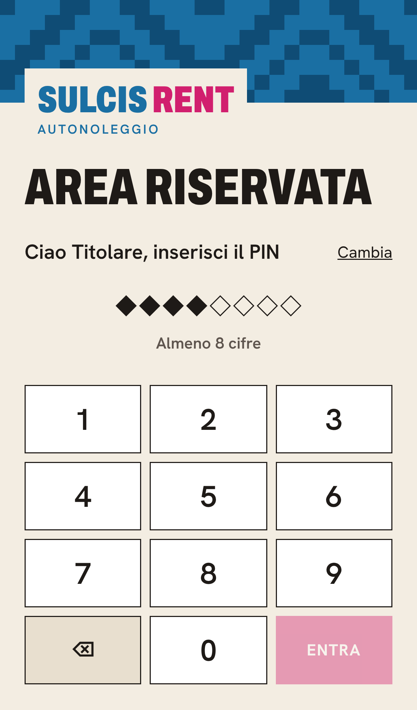
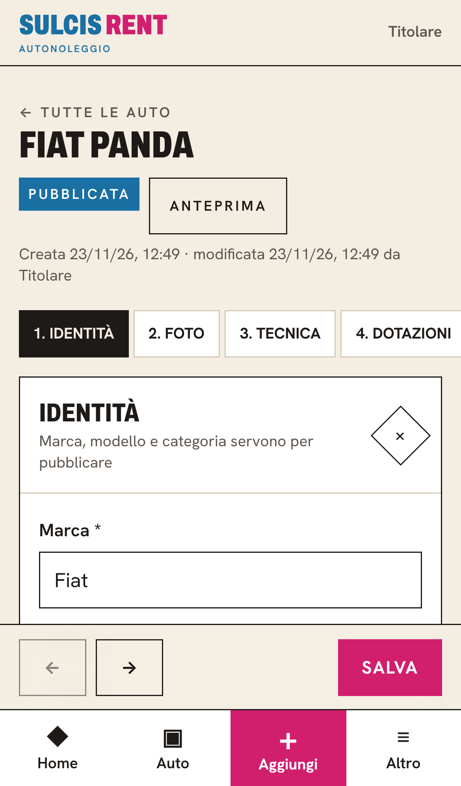
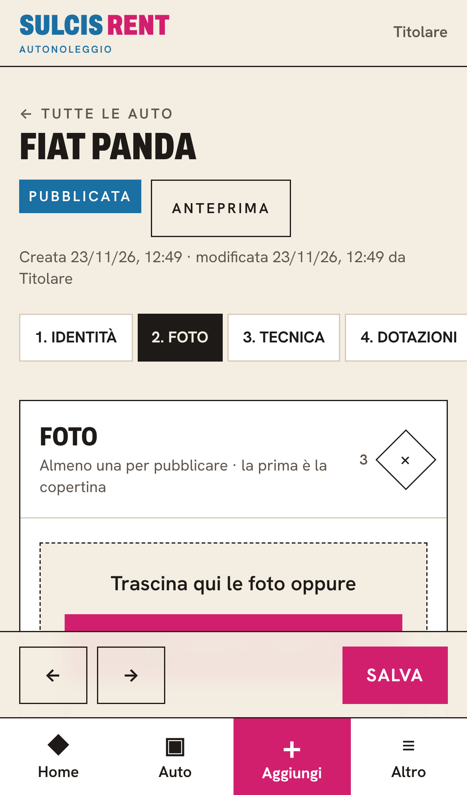
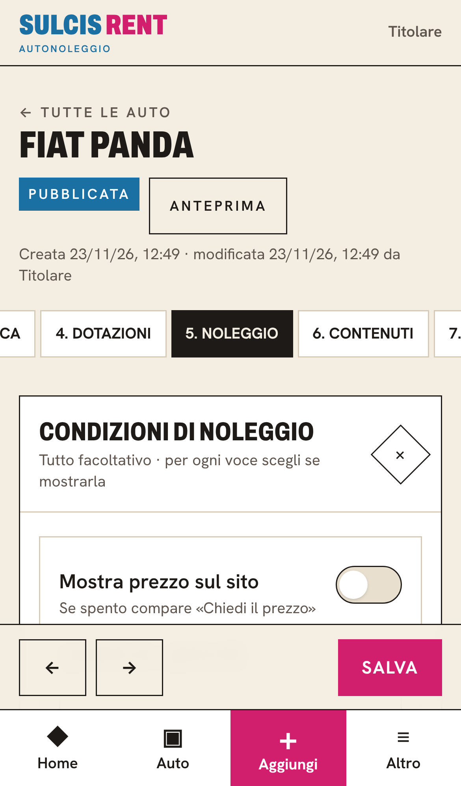

# Guida all'area riservata · Sulcis Rent

*Come aggiungere e gestire le auto sul sito, anche dal telefono, in piazzale.*

---

## 1. Entrare

1. Apri **sulcisrent.it/admin** sul telefono o sul computer.
   Consiglio: aggiungila alla schermata Home del telefono (Safari: Condividi → «Aggiungi alla schermata Home»; Chrome: ⋮ → «Aggiungi a schermata Home»).
2. Tocca **il tuo nome**.
3. Scrivi il **tuo PIN** sul tastierino e tocca **Entra**.

> 🔒 Il PIN è personale: non dirlo a nessuno e non scriverlo sul telefono.
> Se sbagli 5 volte, l'accesso si blocca per 15 minuti (poi per più tempo). Se capita, aspetta oppure chiedi al titolare di sbloccarti.

Resti dentro fino a 8 ore senza usarlo. Per uscire: **Altro → Esci**.

---

## 2. Aggiungere un'auto dal telefono

Tocca il pulsante rosa **+ Aggiungi** in basso. Il modulo è diviso in **passi** (1. Identità, 2. Foto…): scorri con le frecce **←  →** in basso o tocca il nome del passo.

### Passo 1 · Identità
- **Marca**, **Modello** e **Categoria** sono obbligatori per pubblicare.
- **Versione**: per esempio «1.2 Lounge» (facoltativa).
- **Targa**: serve solo a voi. **Non compare mai sul sito.**
- L'indirizzo della pagina (es. `sulcisrent.it/flotta/fiat-panda`) si crea da solo.

### Passo 2 · Foto
1. Tocca **📷 Scatta foto** per usare la fotocamera, oppure **Scegli dalla galleria**.
2. Puoi caricarne più di una: vedi la barra di avanzamento per ognuna.
3. **La prima foto è la copertina**: per cambiare l'ordine tieni premuto ⠿ e trascina.
4. Sotto ogni foto puoi scrivere una breve descrizione (es. «Fiat Panda bianca, vista laterale»): aiuta Google e chi usa lettori di schermo.

> Alla prima foto la bozza viene salvata in automatico.
> Le foto vengono ridotte e la **posizione GPS viene cancellata**, quindi nessuno vede dove sono state scattate.
> Se una foto dà errore (connessione debole), tocca **Riprova**.

### Passo 3 · Tecnica
Alimentazione, cambio, posti, porte, valigie e così via. Compila solo ciò che sai: **i campi vuoti non compaiono sul sito** (niente «N/D»).
Per le **elettriche** e i **furgoni** compaiono campi in più (autonomia, volume di carico…).

### Passo 4 · Dotazioni
Tocca le dotazioni presenti (aria condizionata, Bluetooth, CarPlay…). Diventano blu quando sono selezionate.

### Passo 5 · Noleggio
- **Mostra prezzo sul sito**: se è spento, il sito scrive «Chiedi il prezzo». Se è acceso, compare «da 35 €/giorno».
- Chilometri, cauzione, età minima, consegna…: per ogni voce puoi togliere la spunta **«mostra sul sito»** se preferisci non pubblicarla.

### Passo 6 · Contenuti
- **Descrizione breve**: una frase per la scheda (massimo ~160 caratteri).
- **Descrizione lunga**: con grassetto, elenchi e link.
- **Perfetta per…**: famiglie, coppie, isole minori…
- **Punti di forza**: fino a 3 righe brevi.
- Ogni testo ha le linguette **IT / EN**: se lasci vuoto l'inglese, sul sito inglese compare l'italiano.
- **Messaggio WhatsApp**: facoltativo. Se è vuoto il sito usa «Ciao Sulcis Rent! Vorrei informazioni per noleggiare la *[auto]*…».

### Passo 7 · Pubblicazione
- **Bozza**: salvata ma non visibile.
- **Pubblicata**: visibile sul sito, **subito**.
- **Nascosta**: non visibile ma non eliminata (es. auto in officina).
- **In evidenza in home**: la mette tra le prime.
- **Note interne**: solo per voi, mai sul sito.

Alla fine tocca **Salva** (o **Pubblica**). Compare un messaggio verde di conferma.

> Se esci senza salvare, il telefono ti avvisa: «Hai modifiche non salvate».

---

## 3. Le azioni veloci (lista Auto)

Da **Auto** vedi tutte le auto con foto, stato e categoria. Sotto ogni auto:

| Pulsante | Cosa fa |
|---|---|
| **Pubblica / Nascondi** | la mostra o la toglie dal sito, all'istante |
| **Modifica** | apre il modulo |
| **Duplica** | crea una copia in bozza (utile per due esemplari uguali). La targa non viene copiata |
| **Elimina** | la sposta nel **Cestino**, dove resta **30 giorni** prima di sparire definitivamente |

- **Cambiare l'ordine sul sito**: tieni premuti i puntini ⋮⋮ a sinistra e trascina.
- **Anteprima**: mostra la scheda come la vedranno i clienti, anche se è in bozza.

---

## 4. Recuperare un'auto eliminata

**Altro → Cestino → Ripristina**. Torna com'era (pubblicata, nascosta o bozza).

---

## 5. Recensioni e domande frequenti

- **Recensioni**: copia **solo recensioni vere da Google**, con nome, testo, stelle e data originali.
- **FAQ**: domande e risposte del sito. Le frecce ↑ ↓ cambiano l'ordine.

---

## 6. Solo per il titolare

- **Impostazioni**:
  - telefono, WhatsApp e messaggio standard;
  - indirizzo, orari, Instagram/Facebook, link alle recensioni Google, P.IVA;
  - categorie, dotazioni e tag disponibili nel modulo.
- **Utenti e sessioni**:
  - crea un utente per ogni collaboratore, ognuno con il suo PIN, comunicato di persona;
  - **Reset PIN** se qualcuno lo dimentica;
  - **Sblocca** se qualcuno ha sbagliato troppe volte;
  - **Disattiva** se un collaboratore non lavora più con voi;
  - **Disconnetti tutti** se perdi un telefono.
- **Registro attività**: chi ha fatto cosa, e quando.
- **Backup**: scarica una copia di tutto (auto, foto, testi). Fallo una volta al mese e conservalo al sicuro.

---

## 7. Cambiare il proprio PIN

**Altro → Il mio PIN**. Serve quello attuale; il nuovo deve avere almeno 8 cifre e **non** può essere una sequenza (12345678), una ripetizione (11111111) o una data (01012000).
Dopo il cambio, gli altri tuoi dispositivi dovranno rifare l'accesso.

---

## 8. Cosa NON fa il pannello (di proposito)

Il sito **non prende prenotazioni** e **non mostra disponibilità o date**: ogni cliente vi scrive su **WhatsApp** o vi **chiama**, e siete voi a confermare. Il pannello decide solo **cosa si vede** sul sito.

---

*Problemi? Contatta MTDEVSTUDIO — mtdevstudio.it*
